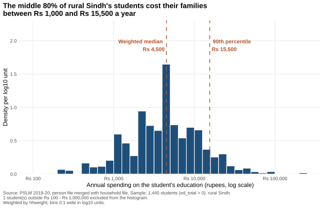
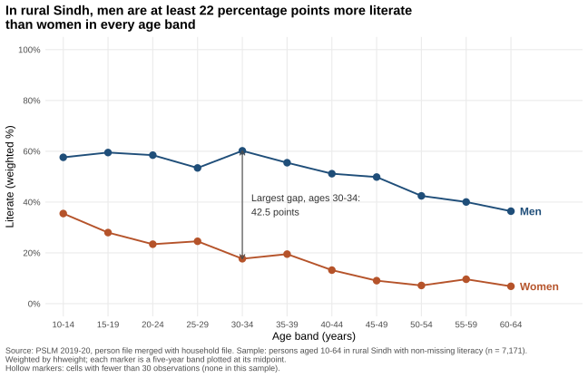
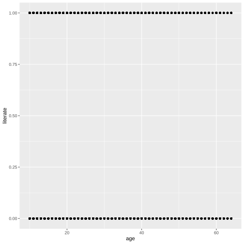
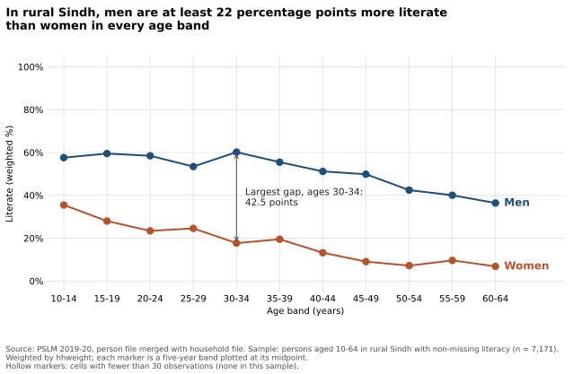

# ECO346 Assignment 1: Education Spending and Literacy in Rural Sindh

**Student:** Muhammad Rubeem Afzal | **Reg. no.:** FA24-BED-058 | **Section:** B
**Course:** Data Visualization Techniques for Economists, COMSATS University Islamabad, Lahore Campus

**Variant 2: Sindh rural.** The registration number ends in 58, and 58 = 7 × 8 + 2, so the remainder is 2. Only persons living in rural Sindh (`prov_code = 3`, `urban_rural = 1`) are used.

## Contents

1. [Data and definitions](#data-and-definitions)
2. [Repository and how to reproduce](#repository-and-how-to-reproduce)
3. [The distribution: education spending](#the-distribution-education-spending)
4. [The relationship: literacy by age and sex](#the-relationship-literacy-by-age-and-sex)
5. [The makeover: default and redesign](#the-makeover-default-and-redesign)
6. [A second language: Python](#a-second-language-python)
7. [Presentation](#presentation)

---

## Data and definitions

- **Source:** Pakistan Bureau of Statistics, PSLM 2019-20 (`data/pslm_person_subset.csv`, `data/pslm_hh_subset.csv`).
- **Merge:** the person file has no weight, province or area, so `hhweight`, `prov_code` and `urban_rural` are attached from the household file by `hhid`.
- **Weights:** every statistic is weighted by `hhweight`. A weighted mean is Σwx / Σw.
- **Weighted quantile:** sort by x, compute the cumulative share of weight, and take the smallest x whose share reaches or exceeds p. R's built-in `quantile()` is not used.
- **Students (Question 2):** persons in the variant with `ed_total > 0` (annual spending on that person's education, in rupees).
- **Literacy sample (Questions 3 to 5):** persons in the variant aged 10-64 with non-missing `literate`.
- **Age bands:** five years wide, 10-14 to 60-64 (eleven bands), plotted at their midpoints (12, 17, ..., 62). A cell with fewer than 30 unweighted observations is thin.

---

## Repository and how to reproduce

```
ECO346-A1-FA24-BED-058/
|-- README.md                        this file
|-- data/
|   |-- pslm_person_subset.csv
|   `-- pslm_hh_subset.csv
|-- scripts/
|   |-- 01_default.R                 default scatterplot (Question 4)
|   |-- 02_distribution.R            weighted histogram (Question 2)
|   |-- 03_literacy.R                literacy figure and band table (Questions 3, 4)
|   `-- 04_literacy.py               Python band table and figure (Question 5)
|-- figures/
|   |-- default.svg
|   |-- distribution.svg
|   |-- literacy_by_age.svg
|   `-- literacy_by_age_python.svg
|-- tables/
|   |-- band_table_R.csv
|   `-- band_table_python.csv
`-- slides/
    `-- FA24-BED-058.pptx
```

Run the scripts in order, from the repository root. No internet connection is needed: they read the local copies in `data/`, and every figure is saved as SVG by the script that draws it.

```
Rscript scripts/01_default.R
Rscript scripts/02_distribution.R
Rscript scripts/03_literacy.R
python scripts/04_literacy.py
```

Requirements: R with `ggplot2`, `svglite` and `dplyr`; Python with `pandas`, `numpy` and `matplotlib`.

---

## The distribution: education spending



Script: `scripts/02_distribution.R`. Weighted histogram on a log scale with bins 0.1 wide in log10 units from 2.0 to 6.0 (Rs 100 to Rs 1,000,000). The vertical axis is density per log10 unit. Dashed lines mark the weighted median and the weighted 90th percentile. The statistics below use all 1,440 students; the one student outside the range is left out of the histogram only.

| Statistic | Value |
|---|---|
| Number of students | 1,440 |
| Weighted median | Rs 4,500 |
| Unweighted median | Rs 4,295 |
| Weighted 10th percentile | Rs 1,000 |
| Weighted 90th percentile | Rs 15,500 |
| Ratio of 90th to 10th percentile | 15.50 |
| Students excluded from the histogram (outside Rs 100 to Rs 1,000,000) | 1 |

**What the figure shows (69 words).**
Most students cost their households between about Rs 1,000 and Rs 15,500 a year, a 15.5-fold spread, with a long tail of costlier cases reaching Rs 250,000. The weighted median (Rs 4,500) is about 5% above the unweighted one (Rs 4,295). Weights matter because households were sampled at unequal rates: in the lowest-weight third of students the median is only Rs 4,000, so ignoring weights slightly understates typical spending.

---

## The relationship: literacy by age and sex



Script: `scripts/03_literacy.R`. Weighted literacy rate (0 to 100 percent) against age band, plotted at band midpoints, with women and men as two series of markers joined by lines. Series are labelled directly at their ends, and the band with the largest gap is annotated. Hollow markers mark thin cells (fewer than 30 observations for that sex in that band); none occur here, because the smallest cell has 77 observations.

Literacy sample: 7,171 persons (3,783 men and 3,388 women). *n* is the unweighted number of persons; rates are weighted percentages. Full table in `tables/band_table_R.csv`.

| Band | Midpoint | Women n | Women literate (%) | Men n | Men literate (%) | Gap (points) |
|---|---|---|---|---|---|---|
| 10-14 | 12 | 529 | 35.5 | 718 | 57.6 | 22.1 |
| 15-19 | 17 | 446 | 28.0 | 548 | 59.5 | 31.5 |
| 20-24 | 22 | 455 | 23.4 | 422 | 58.5 | 35.1 |
| 25-29 | 27 | 430 | 24.6 | 419 | 53.4 | 28.9 |
| 30-34 | 32 | 399 | 17.7 | 382 | 60.2 | 42.5 |
| 35-39 | 37 | 319 | 19.5 | 391 | 55.5 | 36.0 |
| 40-44 | 42 | 285 | 13.2 | 274 | 51.2 | 38.0 |
| 45-49 | 47 | 198 | 9.1 | 221 | 49.9 | 40.8 |
| 50-54 | 52 | 152 | 7.2 | 208 | 42.4 | 35.3 |
| 55-59 | 57 | 98 | 9.6 | 100 | 40.0 | 30.4 |
| 60-64 | 62 | 77 | 6.8 | 100 | 36.4 | 29.6 |

**Key numbers**

| | Women | Men |
|---|---|---|
| Aged 15-19 | 28.0% | 59.5% |
| Aged 55-59 | 9.6% | 40.0% |

The band with the largest gap is **30-34**, where men lead women by 42.5 percentage points.

**Interpretation (79 words).**
Men are more literate than women in every band, by 22 to 43 points. Women's rates fall from 35.5% at ages 10-14 to under 10% from age 45, while men stay between 36% and 60%. The gap is narrowest among the youngest (22.1 points) but as wide at 15-19 (31.5) as at 55-59 (30.4), so convergence is weak. One cross-section mixes age and birth-cohort effects. It cannot tell us why: school supply and household demand look the same here.

---

## The makeover: default and redesign

| Default (R, nothing added) | Redesign (Question 3) |
|---|---|
|  |  |

The default is `ggplot(data, aes(age, literate)) + geom_point()` on the literacy sample, produced by `scripts/01_default.R` and committed before the redesign.

**Explanation of the redesign (134 words).**
The default plots 7,171 yes/no observations as dots on two lines, so thousands overplot and no trend is visible. I made three changes. First, I replaced raw points with weighted conditional means by age band, so literacy is read by position on a common scale, the most accurate perceptual channel. Second, I split women and men into two lines labelled directly instead of using a legend, and removed the grey panel and minor gridlines to raise the data-ink share. Third, I used `hhweight` so the rates describe rural Sindh rather than the sample, and added hollow markers for thin cells, an annotated largest gap and a title that states the finding. What the default shows that the redesign hides: single years of age and the individual 0/1 outcomes, so variation within each band disappears.

---

## A second language: Python



Script: `scripts/04_literacy.py`. It recomputes the band table (`tables/band_table_python.csv`) and redraws the Question 3 figure. When `tables/band_table_R.csv` exists, the script compares the two tables and prints the largest difference.

| | Literacy rate |
|---|---|
| Women aged 15-19, from R | 28.0% |
| Women aged 15-19, from Python | 28.0% |

The two band tables agree to one decimal place.

**A default that differed (64 words).**
Axis padding differed. ggplot2 expands each axis by 5% beyond its limits, so my 0-100 scale displayed from about -5 to 105, whereas matplotlib's `set_ylim(0, 100)` adds no padding. I set `ylim(-5, 105)` explicitly in Python, and `xlim(10, 70)` to match R's limits, so the figures look the same. Both scripts build bands as `floor(age / 5) * 5`, and the band tables agree.

---

## Presentation

Slides: [`slides/FA24-BED-058.pptx`](slides/FA24-BED-058.pptx), at most four slides covering the variant, the makeover (default and redesign side by side), and the one finding I consider most important: men lead women in literacy by 22 to 43 points in every age band, and the gap is as wide at ages 15-19 (31.5 points) as at 55-59 (30.4 points).
